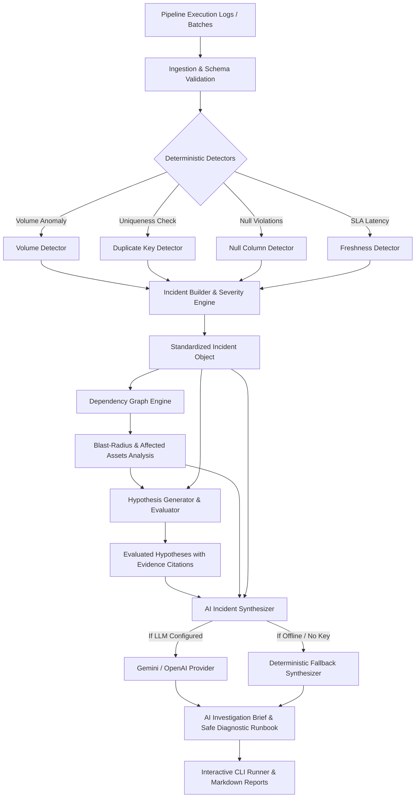

# Data Incident Investigator

> **AI-Powered Data Pipeline Root-Cause Analysis Platform**  
> A production-style, evidence-grounded incident investigation system for enterprise data pipelines.

---

# Data Incident Investigator

> **AI-Powered Data Pipeline Root-Cause Analysis Platform**  
> A production-style, evidence-grounded incident investigation system for enterprise data pipelines.

---

## 1. Project Overview & Core Features

**Data Incident Investigator** automates triage, blast-radius analysis, and root-cause hypothesis evaluation for data pipeline outages.

Rather than emitting disconnected alert notifications or relying on unconstrained LLM hallucinations, the platform enforces strict **causal rigor** across six core modules:

- **Feature A — Pipeline Execution Log Ingestion (`ingestion/`)**: Robust parsing and schema validation of structured pipeline run metadata, capturing record counts, run states, and execution timestamps.
- **Feature B — Deterministic Anomaly Detectors (`detection/`)**: Rule-based detection algorithms identifying volume anomalies (percentage record drops), duplicate primary keys, null-ratio violations, and freshness SLA latency breaches.
- **Feature C — Standardized Incident Model & Severity Engine (`incident/`)**: Packaging verified anomalies into structured, immutable `Evidence` items (`EVD-001`, `EVD-002`) with deterministic severity ranking (`CRITICAL > HIGH > MEDIUM > LOW`) and Markdown incident report generation.
- **Feature D — Dependency Lineage & Causal Hypothesis Evaluation (`dependency/` & `investigation/`)**: Directed Acyclic Graph (DAG) modeling with cycle detection, transitive upstream/downstream impact tracing, and strict causal evaluation (`SUPPORTED`, `CONTRADICTED`, `INSUFFICIENT_EVIDENCE`). Lineage proximity is never confused with causation.
- **Feature E — Grounded AI Synthesis & Deterministic Fallback (`ai/`)**: Evidence-grounded synthesis producing executive briefs and safe, read-only diagnostic actions. Includes automatic citation pruning, root-cause hallucination guards, and an offline rule-based fallback when no external API credentials are provided.
- **Feature F — Interactive CLI & Automated Scenario Suite (`cli/`)**: A human-friendly terminal interface and scripted scenario runner that demonstrates end-to-end investigation across four distinct real-world scenarios.

---

## 2. Architecture & Data Flow



---

## 3. Quick Start & Execution

### Prerequisites
- Python 3.10+
- `pip`

### Installation
Clone the repository and install test dependencies:
```bash
git clone https://github.com/maneesh499/data_incident_investigator.git
cd data_incident_investigator
pip install -r requirements.txt
```

### Launch Interactive Demonstration CLI
To launch the interactive console runner from the repository root:
```bash
python run_demo.py
```
Or execute via Python module syntax:
```bash
python -m src.incident_investigator
```

### Direct Scenario Execution
Run any scenario directly by number without entering the interactive prompt:
```bash
# Scenario 1: Critical Ingestion Volume Drop (-38%)
python run_demo.py 1

# Scenario 2: Silver Layer Quality Failure (Duplicate Keys & Nulls)
python run_demo.py 2

# Scenario 3: Gold Revenue Mart Freshness SLA Breach (10h Lag)
python run_demo.py 3

# Scenario 4: Healthy Pipeline Run (All Checks Passing)
python run_demo.py 4
```

---

## 4. Demonstration Scenarios

| Scenario # | Title | Target Pipeline | Detected Anomalies | Blast Radius | Root Cause Status |
|---|---|---|---|---|---|
| **1** | **Critical Ingestion Volume Drop** | `orders_ingestion` | 38% volume drop (6.2M vs 10M expected) | 6 downstream assets | `UNCONFIRMED_PENDING_EVIDENCE` (both upstream source and internal filter hypotheses require deeper telemetry) |
| **2** | **Silver Layer Quality Failure** | `orders_cleaning_pipeline` | 1 duplicate primary key (`order_id`), 25% null customer IDs | 4 downstream assets | Both duplicate keys and null violations are `SUPPORTED` by direct evidence in the batch |
| **3** | **Gold Mart Freshness Breach** | `revenue_mart_pipeline` | 10.0 hours lag vs 4.0 hours SLA threshold | 2 downstream assets | Freshness SLA breach is `SUPPORTED` by direct timestamp evidence |
| **4** | **Healthy Pipeline Run** | `orders_ingestion` | 100% volume, 0 violations | 0 affected assets | Zero incidents opened; verifies zero false-positive alerts |

---

## 5. Optional AI Provider Configuration

The platform operates **100% offline out-of-the-box** using its built-in `DeterministicSynthesizer`. No external API keys or cloud services are required.

To enable live LLM synthesis, set the appropriate environment variable:

### Using OpenAI
```bash
# Windows PowerShell
$env:OPENAI_API_KEY = "your-api-key"

# Linux / macOS
export OPENAI_API_KEY="your-api-key"
```

### Using Google Gemini
```bash
# Windows PowerShell
$env:GEMINI_API_KEY = "your-api-key"

# Linux / macOS
export GEMINI_API_KEY="your-api-key"
```

### Fallback Guarantee
If neither key is set, or if an API provider returns an error (rate limits, network timeout, service interruption), the engine automatically engages `DeterministicSynthesizer`. The investigation output is **never lost, interrupted, or falsified**.

---

## 6. Architectural Safeguards & AI Safety

1. **Evidence-Grounded Prompting**: The AI model only receives verified `InvestigationResult` data. Factual claims must reference real Evidence IDs (`EVD-001`, `EVD-002`).
2. **Citation Filtering**: Any evidence ID hallucinated by an LLM that was not part of the verified incident is automatically stripped.
3. **Unconfirmed Root Cause Guarantee**: If deterministic checks and lineage cannot prove a root cause, the synthesizer overrides any premature AI "confirmed" claim back to `UNCONFIRMED_PENDING_EVIDENCE`.
4. **Non-Destructive Recommendations**: Operational actions generated by the system only recommend safe, read-only diagnostic checks (`SELECT count(*)`, `grep`, `airflow dags state`), never destructive mutations (`DROP`, `DELETE`, `TRUNCATE`).
5. **Zero-Failure Fallback**: If external network calls fail or credentials are absent, the system engages `DeterministicSynthesizer` without crashing.

---

## 7. Example Output (Scenario 1)

```text
==============================================================================
  DATA INCIDENT INVESTIGATOR  |  Root-Cause Analysis Platform
  Deterministic Validation  *  Dependency Tracing  *  AI Synthesis
==============================================================================

##############################################################################
  SCENARIO 1: CRITICAL INGESTION VOLUME DROP (-38% RECORD LOSS)
##############################################################################

1. PIPELINE EXECUTION INGESTION
   Pipeline:         orders_ingestion
   Run ID:           run_001
   Execution Status: SUCCESS
   Actual Records:   6,200,000
   Expected Records: 10,000,000

2. DETERMINISTIC DETECTOR FINDINGS
   [*] Volume anomaly detected! Record count dropped by 38.00% (Expected: 10000000, Actual: 6200000). Threshold is 10.0%.

3. STANDARDIZED INCIDENT RECORD
   Incident ID:     INC-orders_ingestion-run_001
   Severity:        CRITICAL
   Status:          OPEN
   Root Cause:      UNCONFIRMED (Strict Causality)
   Evidence Items Recorded:
     - [EVD-001] (CRITICAL) volume_detector: Volume anomaly detected! Record count dropped by 38.00%.

4. DEPENDENCY & BLAST-RADIUS ANALYSIS
   Target Asset:    orders_ingestion
   Direct Upstream:   E-Commerce PostgreSQL Orders Table (source_orders_db)
   Potentially Affected Assets (6 total):
     -> [STORAGE_CONTAINER] Bronze Raw Orders Lake Storage (bronze_orders)
     -> [TRANSFORMATION_PIPELINE] Orders Deduplication and Cleaning Pipeline (orders_cleaning_pipeline)
     -> [TABLE] Silver Cleaned Orders Table (silver_orders)
     -> [TRANSFORMATION_PIPELINE] Daily Revenue Aggregation Pipeline (revenue_mart_pipeline)
     -> [DATA_MART] Gold Daily Sales & Revenue Mart (gold_daily_revenue)
     -> [DASHBOARD] Executive Sales PowerBI Dashboard (executive_sales_dashboard)

5. EVIDENCE-BASED HYPOTHESIS EVALUATION
   [INSUFFICIENT_EVIDENCE] Upstream Source Under-Delivered Records (HYP-001)
      Citing Evidence: EVD-001
      Evaluation:      Local volume anomaly is verified by evidence EVD-001, but local volume drop cannot prove an upstream source under-delivered without direct source database CDC logs.
   [INSUFFICIENT_EVIDENCE] Pipeline Extraction or Filtering Logic Dropped Records (HYP-002)
      Citing Evidence: EVD-001
      Evaluation:      Volume drop anomaly is verified by evidence EVD-001, but aggregate output counts cannot prove internal extraction logic caused the drop without step-level discard metrics.

6. AI INVESTIGATION SYNTHESIS BRIEF
   Provider:         deterministic_fallback
   Fallback Mode:    True
   Confidence Score: 90%
   Executive Summary:
     Incident INC-orders_ingestion-run_001 occurred on pipeline 'orders_ingestion' (Run ID: run_001) with severity CRITICAL. Lineage analysis traced 1 upstream dependencies and identified 6 potentially affected downstream assets. Evaluated 2 candidate causal hypotheses against verified evidence.

   Recommended Operational Actions:
     [HIGH] ACT-001 on `source_orders_db`: Query upstream asset 'source_orders_db' to determine if the volume drop originated at the source. | Command: `SELECT count(*) FROM source_orders_db WHERE event_date = CURRENT_DATE;`
     [HIGH] ACT-002 on `orders_ingestion`: Inspect pipeline 'orders_ingestion' task logs and SQL query execution plan for filter discards. | Command: `grep -iE '(filter|discard|drop|timeout)' /var/log/pipeline/*.log`
     [MEDIUM] ACT-003 on `bronze_orders`: Notify downstream consumers of potentially impacted data assets.

[+] Saved comprehensive Markdown report to: data/incidents/report_scenario_volume_drop.md
```

---

## 8. Automated Testing

Run the full pytest suite (all 76 tests):
```bash
pytest -v
```

Test coverage includes:
- Ingestion schema validation and malformed JSON handling
- Deterministic volume drops, duplicate keys, null rates, and freshness SLA checks
- Incident builder, severity hierarchy, and markdown report generation
- Dependency DAG operations, transitive ancestor/descendant tracing, and cycle detection
- Hypothesis generator and strict causal evaluator (`SUPPORTED`, `CONTRADICTED`, `INSUFFICIENT_EVIDENCE`)
- AI synthesizer prompt formatting, citation pruning, provider errors, and fallback recovery
- Interactive CLI scenario execution, report persistence, and error handling

---

## 9. Assumptions, Limitations & Future Roadmap

- **Simulated Lineage & Telemetry**: Lineage graphs and execution logs are loaded from realistic JSON fixtures (`data/raw/` and `data/fixtures/`). No live cloud connections (AWS/Azure/Databricks) are required.
- **Strict Causality Boundary**: The platform deliberately refuses to claim an upstream source caused a failure unless boundary CDC or query logs verify it.
- **Report Persistence**: Generated incident reports are saved locally to `data/incidents/`.
- **Future Improvements**:
  - OpenLineage / Marquez event stream adapter for real-time streaming ingestion.
  - Direct dbt-manifest lineage parser to generate dependency graphs directly from dbt projects.
  - Slack / PagerDuty webhook alerting dispatcher for confirmed high-severity incidents.

